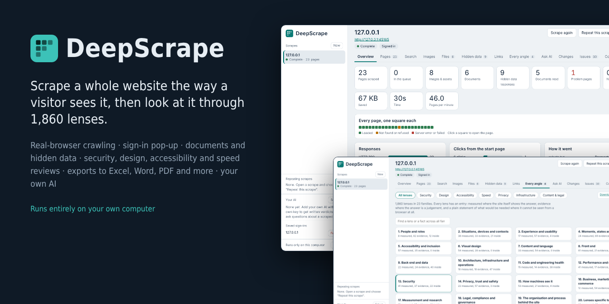
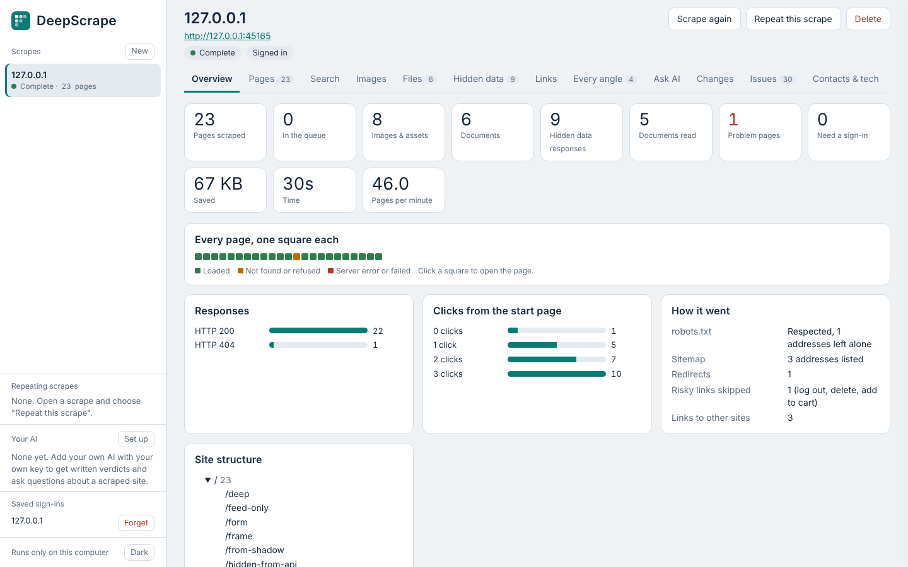
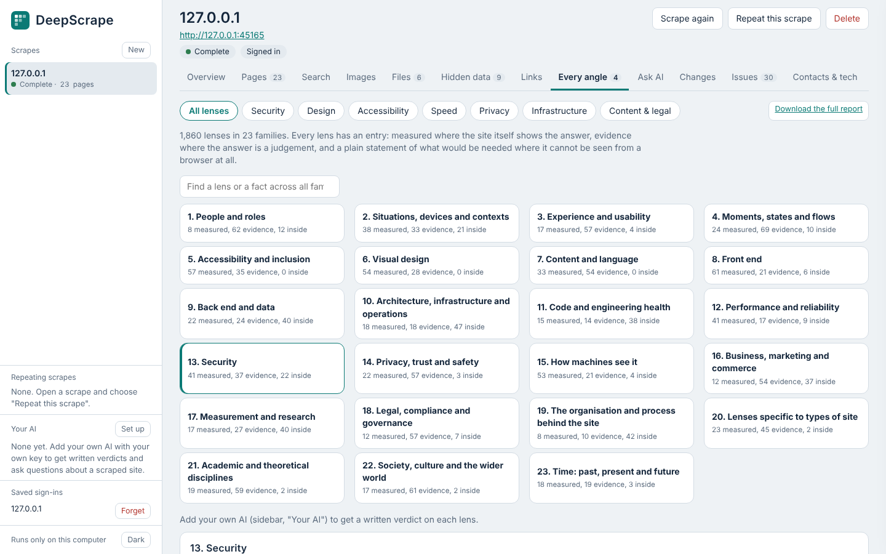
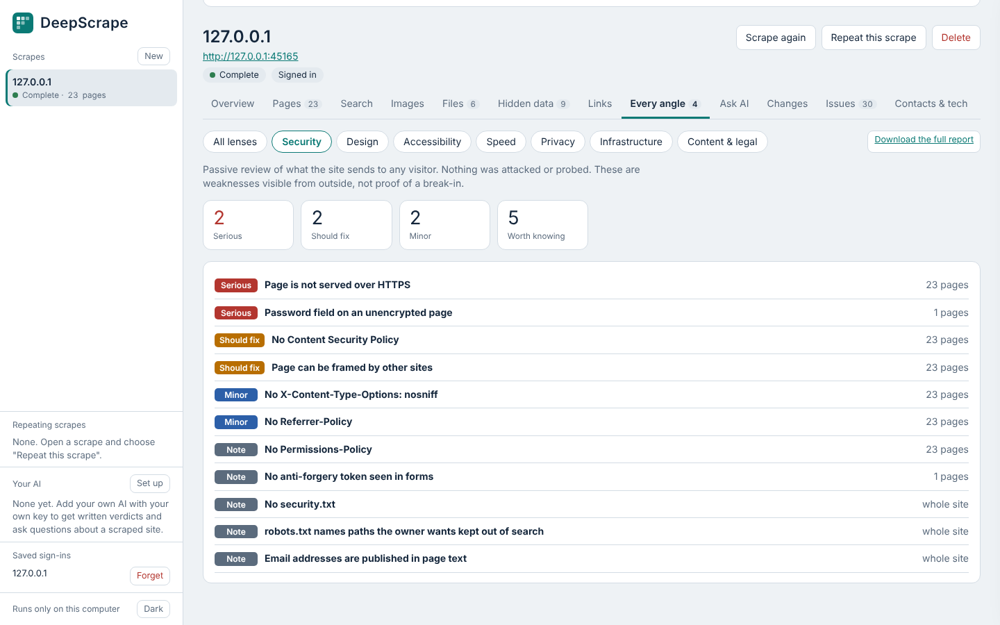
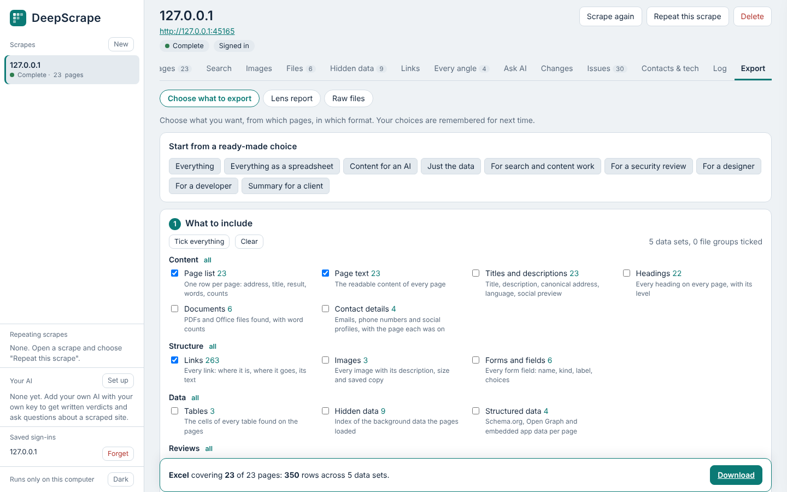
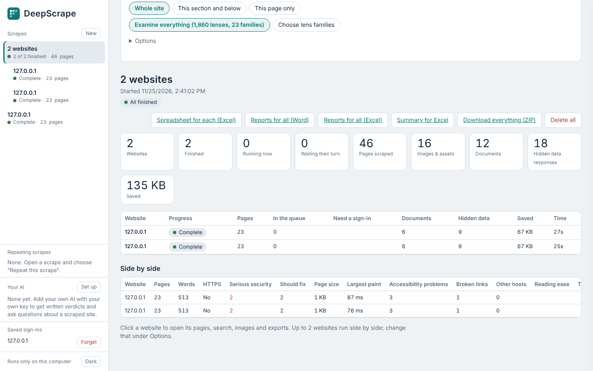
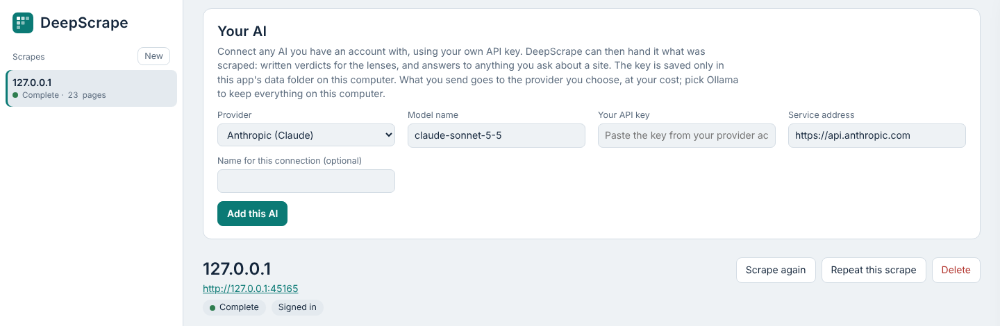

# DeepScrape



Scrape a whole website the way a visitor sees it, then look at it from every angle. Paste a link
into a dashboard that runs on your own computer; every page is opened in a real browser, and the
text, documents, images and background data behind it are saved. When it finishes you get reviews
of security, design, accessibility, speed and privacy, a library of 1,860 lenses to read the site
through, and exports to Excel, Word, PDF and more.

> **Status:** early release. It runs on my own PC and passes its own test suite against a built-in
> practice site, but it has not been tested widely on real websites yet. Expect rough edges.

## What it does

- **Scrapes like a browser:** renders JavaScript, scrolls, opens tabs and "show more", and follows the sitemap, feeds and addresses hidden in background data.
- **Handles sign-ins properly:** a normal browser window opens for you to sign in yourself, once per site. Your password is never read or stored.
- **Reads beyond the page:** text inside PDFs, Word, Excel and PowerPoint files, and optionally inside images.
- **Several websites at once,** with a side-by-side comparison.
- **Reviews from every angle:** graded security findings (passive only), design tokens, accessibility, speed, privacy, infrastructure, content and legal.
- **1,860 lenses in 23 families,** each marked as measured, evidence gathered, or needing inside access.
- **Your own AI:** connect Claude, ChatGPT, Gemini, Ollama or any OpenAI-compatible service with your own key for written verdicts and questions about a site.
- **Exports you choose:** pick the data sets, the pages and the format (Excel, ZIP, CSV, JSON, Markdown, Word, PDF, web page).
- **Changes over time:** compare two scrapes, or repeat one on a schedule.

| Finished scrape | Lens library |
| --- | --- |
|  |  |

| Security review | Choosing what to export |
| --- | --- |
|  |  |

| Several websites side by side | Your own AI |
| --- | --- |
|  |  |

## Use it responsibly

DeepScrape respects `robots.txt` by default, never follows links that change things (log out,
delete, add to cart), slows down when a site asks it to, and does not get around CAPTCHAs or bot
protection. Its security review only reads what a site sends to any visitor; it never attacks or
probes. Scrape your own sites, or sites you have permission to scrape. A site's terms, copyright
and privacy law (POPIA in South Africa, GDPR in Europe) still apply to what you collect.

## Start

**Windows app:** run `DeepScrape-Setup-<version>.exe`. It installs for your
Windows account only (no administrator rights), adds DeepScrape to the Start menu
and the desktop, and opens the dashboard in its own window. Node.js is not needed.
Scrapes are saved in `Documents\DeepScrape\data`. The installer is not code-signed,
so Windows may show a "Windows protected your PC" notice the first time: choose
**More info**, then **Run anyway**.

**From source on Windows:** double-click `Start DeepScrape.bat`. The first run
installs what it needs; after that the dashboard opens at <http://localhost:4780>.

**From source on any system:** `npm install` once, then `npm start` (dashboard in
your browser) or `npm run app` (dashboard in its own window).

Running from source needs [Node.js 18+](https://nodejs.org). Either way, DeepScrape
drives Google Chrome or Microsoft Edge if one is installed; otherwise run
`npx playwright install chromium` once.

### Building the Windows app

`npm run dist:win` builds `dist/DeepScrape-win32-x64` (the app folder) and
`dist/DeepScrape-Setup-<version>.exe` (the installer). It works from Windows, macOS
or Linux and needs [NSIS 3](https://nsis.sourceforge.io) (`makensis`) on the PATH for
the installer step. `npm run icon` redraws the app icon.

## Using the dashboard

1. Paste or drag a link into the box and press **Scrape**. Several links, one
   per line, start several scrapes.
2. Choose **Whole site**, **This section and below** or **This page only**.
3. Watch it run. Each square is a page; click one to open everything saved for it.

### Several websites at once

Put one address per line in the box (Shift+Enter starts a new line, or just
paste a list), or press **Import a list** and pick a text, CSV or bookmarks
file; every web address in it is picked up and duplicates are dropped. The
button then reads "Scrape N websites".

They run as one batch: a few side by side (two by default, set **Websites
scraped side by side** under Options, up to 8) and the rest wait their turn.
The batch page shows every website's progress in one table, with **Pause all**,
**Stop all**, a **Summary for Excel** (one row per website with page counts,
contact details and technology) and **Download everything (ZIP)** with a folder
per website. Click any website to open its own pages, search and exports. If
one needs a sign-in, only that one waits for you; the others keep going.

### Sites that need a sign-in

When a page turns out to be behind a sign-in, the scrape pauses and a normal
browser window opens on the sign-in page. Sign in there yourself (two-factor
codes work too). The scrape notices when you are through and carries on with
your session, including the page that was blocked. The same window is used if a
site shows an "are you human" check: you complete it, DeepScrape does not.

The window opens **once per site, per scrape**. If you close it, or press
*Skip this site*, that site is not asked for again. Its pages are listed in a
**Waiting on you** panel at the top of the scrape, with the site's name, how
many pages are behind it, and a **Sign in now** button for when you are ready.
Nothing else stops: the rest of the site carries on being scraped.

Your password is typed into the real site in that window. DeepScrape never reads
or stores it. What it keeps is the session (cookies) in `data/sessions/`, so the
next scrape of that site needs no sign-in. Remove one with **Forget** in the
sidebar. Session values are blanked out in the saved results and are not part of
the ZIP export.

Tick **Sign in before starting** when the site shows public pages to visitors
and more to members.

### Your own AI

Under **Your AI** in the sidebar, add any AI you have an API key for: Anthropic
(Claude), OpenAI, Google Gemini, OpenRouter, Mistral, Groq, DeepSeek, xAI, any
other OpenAI-compatible address, or Ollama running on this computer. You can
add several and choose which to use each time. Then:

- **Every angle > All lenses > Write AI verdicts** gives each lens that has
  facts a rating, a one or two sentence verdict and one thing to do. Lenses that
  need inside access are left alone. The verdicts appear in the lens list and
  in every report format.
- **Ask AI** takes any question or instruction about the scraped site. Your AI
  is sent the measured facts and as much page and document text as fits, most
  relevant first, and answers only from that.

Keys are saved in `data/settings.json` on this computer and are never shown
again in the dashboard. Whatever is sent goes to the provider you chose, on
your account. With Ollama nothing leaves the computer.

### Changes over time, and repeating scrapes

Scrape a site a second time and the **Changes** tab shows what is new, gone or
edited: pages, security findings, technology, cookies, other hosts, documents
and the main numbers. **Repeat this scrape** re-runs it every day, week or
month while DeepScrape is open, and the sidebar shows what changed since the
last run.

### Searching a site with your own words

Put words under **Also search the site for these words** and DeepScrape looks
each one up through the site's own search box (where the search works by
address), so pages that only appear in search results are captured too.

## What is saved for every page

| | |
|---|---|
| Content | Clean Markdown, visible text, and all text including collapsed or hidden parts, shadow DOM and iframes |
| Pictures of it | Full-page screenshot; optional single-file `.mhtml` archive |
| Source | Original HTML as sent, and the HTML after JavaScript ran |
| Structure | Headings, links, images with descriptions and sizes, tables as rows and records, lists, forms and fields, buttons, navigation, footer |
| Metadata | Title, description, every meta tag, Open Graph, Twitter cards, canonical, language, icons, feeds |
| Structured data | JSON-LD, microdata, embedded app state (`__NEXT_DATA__`, `__NUXT__`, Redux/Apollo state and others), `data-*` attributes, HTML comments |
| Hidden data | Every background (XHR/fetch) response the page loaded, saved as files, plus WebSocket messages |
| Technical | Status, redirects, response headers, TLS details, cookies, local/session storage, console output, the full network log, load timing |
| Assets | Images (all `srcset` sizes, lazy-loaded, CSS backgrounds), CSS, JavaScript, fonts, video and audio |
| Documents | Linked PDFs, Office files, archives and media are downloaded |

Across the site: contact details, social profiles, technology detected, links to
other sites, a site tree, and checks for broken links, missing titles and
descriptions, duplicate pages, images without descriptions, slow pages and
script errors.

## Beyond the page text

- **Inside documents:** the text of PDFs, Word, Excel, PowerPoint, OpenDocument
  and RTF files is read, saved next to each file, searchable, and included in
  `all-content.md`. Scanned PDFs (pictures of pages) are flagged.
- **Behind clicks:** tabs, accordions, "show more", "read more" and "next" are
  clicked and whatever appears is saved, labelled with what was clicked. Forms
  are never submitted and buttons that sound like they change something
  (delete, buy, send, save, approve and so on) are never clicked.
- **Inside images (optional):** tick *Read text inside images* to read banners,
  posters and scanned notices. English only, and slow.
- **Not in the text at all:** tooltips, field labels, text drawn by styles,
  canvas drawings, public source maps (the site's original code).
- **Pages nothing links to:** found through the sitemap, feeds, `llms.txt`, and
  addresses mentioned inside the site's background data.
- **Two screenshots per page:** desktop and phone width, plus the accessibility
  tree a screen reader receives.

## Lenses: choosing what to examine, and reporting on it

DeepScrape carries a library of **1,860 lenses in 23 families** (people and
roles, situations and devices, usability, moments and flows, accessibility,
visual design, content, front end, back end, operations, code health,
performance, security, privacy, machines, business, measurement, legal, the
organisation, site types, academic disciplines, society, time). The list lives
in `lib/lenses.json`; edit it to add or rename lenses.

**Before scraping** choose *Examine everything* or *Choose lens families*.
Choosing families makes the scrape lighter: screenshots, asset downloads,
document reading and click-through are switched off when no chosen family needs
them.

**After scraping**, the *Every angle* tab lists every lens with its entry, and
*Export > Build a report* makes a report for the families you tick (or all 23)
at the detail you pick (every lens, only lenses with facts, or family
summaries), as:

| Format | Good for |
|---|---|
| Word (.docx) | reading, editing, sharing |
| PDF | sending as-is |
| Excel (.xlsx) | sorting and filtering; extra sheets for pages, security findings, checks, other hosts, cookies, documents, contacts |
| Web page (.html) | opening in a browser |
| Markdown | giving to Claude or another AI for a written verdict |
| CSV, JSON | other tools |

A batch has *Reports for all* buttons that zip one report per website, and a
*Side by side* table lining the finished websites up on size, speed, security,
accessibility, trackers, technology and prices.

Each lens entry is honest about how much a browser can know:

| | |
|---|---|
| **Measured** | Read directly from the site |
| **Evidence gathered** | The facts are collected; the verdict is a judgement for a person or an AI |
| **Needs inside access** | Cannot be seen from outside (database, tests, finances, team). The entry says what would be needed and lists outside hints |

How a lens finds its facts is shown as *matched by*: **this lens** (a
hand-written mapping, about 110 lenses), **its topic** (a rule matched on the
words in the lens name, about 1,300), or **its family** (the general facts for
that family, about 450). Topic and family matches can be loose. Treat them as
where to look, not as a verdict. The mappings are in `lib/lenses.js` and
`lib/perspectives.js` and are meant to be tightened over time.

There are also focused reviews: **Security** (graded findings with fixes),
**Design**, **Accessibility**, **Speed**, **Privacy**, **Infrastructure** and
**Content & legal**. The security review is passive: it reads what the site
sends to any visitor and never sends attacks, guesses passwords or probes for
hidden files.

## Use it from Claude, Claude Code and other tools

DeepScrape is also a tool other programs can drive. **Connect** in the sidebar shows
the exact lines for your copy; in short:

**Claude Code** (run once in a terminal):

```
claude mcp add --scope user --transport stdio deepscrape -- node "/path/to/deepscrape/mcp.js"
```

**Claude desktop app** (Settings, Developer, Edit Config, then restart):

```json
{ "mcpServers": { "deepscrape": { "command": "node", "args": ["/path/to/deepscrape/mcp.js"] } } }
```

With the installed Windows app, the command is `DeepScrape.exe` itself with the
environment value `ELECTRON_RUN_AS_NODE=1`; the Connect panel fills in the paths.
Cursor, VS Code and anything else that speaks the Model Context Protocol (MCP) use the
same command.

Then ask in plain words: "scrape example.com and tell me how secure it is", "what
colours and fonts does this site use", "save the accessibility report as a PDF".

| Tool | What it does |
| --- | --- |
| `scrape_website` | Scrape a site, a section or one page; returns scores when done |
| `list_scrapes`, `get_scrape` | What is on this computer; status, scores and headline results |
| `get_report` | The in-depth report for a topic, as Markdown |
| `list_pages`, `get_page` | Pages, and one page's content, details, design, security or accessibility |
| `search_scrape` | Find text across every page and document |
| `export_scrape` | Save a PDF, Word, Excel or ZIP pack to disk |

The bridge talks to the DeepScrape app on the same computer and starts it in the
background if it is not open, so these scrapes appear in the dashboard and sign-in
windows still open for you. It has no access beyond what the app itself does.

**Scripts and other programs.** Everything the dashboard does goes through a local
API at `http://localhost:4780/api` (only reachable from this computer), for example
`GET /jobs`, `POST /jobs {"url": "..."}`, `GET /jobs/ID/export?topic=security&format=json`.
The command line (`node scrape.js --help`) does the same without the dashboard.

## Speed and accuracy

DeepScrape does not wait on fixed timers. It watches each page's own network requests
and changes, moves on the moment the page has finished building, and ignores requests
that just keep repeating (analytics, polling), which make other tools wait out a
timeout on every page. The number of pages open together adapts: it grows while the
site answers quickly and is cut back the moment the site slows down or says so.

Choose a pace under Options, or `--speed` on the command line:

| Pace | Pages open together | Use it for |
| --- | --- | --- |
| Gentle | 1 to 2 | Small or fragile sites |
| Balanced (default) | 3, growing to 6 | Most sites |
| Fast | 5, growing to 10 | Sites you own or that can take it |
| Custom | You set the numbers | Special cases |

`npm run benchmark` times a scrape of a built-in site with slow-loading data, lazy
images, tabs and a page that never stops polling. On a 2-core machine it went from 27
pages a minute to 117 (Balanced) and 138 (Fast), with identical words, images,
revealed text and screenshots.

**Accuracy check.** Speed must not cost content, so every scrape proves it on the site
itself: at the end, a sample of pages is opened again the slow way (long waits, slow
scrolling) and each line of text seen then is looked up in what was saved. The overview
shows how many sampled pages matched and lists any that differ, with the text involved.
Switch it off under Options or with `--no-self-check`.

## How it finds everything

- Follows every link in the rendered page, including inside shadow DOM and iframes
- Reads `robots.txt` and the sitemap (including sitemap indexes and `.gz`) to find pages nothing links to
- Scrolls each page to the bottom until nothing new loads; opens `<details>` sections
- Optional: keeps clicking a "Load more" button you name, or waits for an element
- Treats `/page`, `/page/`, `?utm_source=...` and redirects as the same page, so nothing is scraped twice
- Retries failed pages, and slows down automatically if the site says it is being hit too fast
- Never follows links that change things: log out, delete, unsubscribe, add to cart
- Can be paused, stopped and continued later, also after closing the app

## Exporting

### By topic

The Export tab opens on **By topic**: Scorecard, Security, Design, Accessibility, Speed,
Privacy, Search and content quality, Technology and hosting, Legal and contacts,
All the content, and **Everything in one report** (every topic in a single document). Pick a topic and a format (PDF report, Word, Excel, Markdown, web
page, JSON, CSV).

Each topic report is written to be read on its own:

- a **summary** in plain sentences, including what the review covers and what it cannot;
- the **score** out of 100 with every point lost, why, and how to fix it, biggest first;
- **page-by-page tables** (for security: every protective header on every page, and
  the security facts of every page; for accessibility: every problem count per page
  with the WCAG criterion; for speed: weight and timings of every page);
- the key facts and full lists from the review, and the data sets behind them.

**Complete pack (ZIP)** adds the report as a web page and Markdown, an Excel workbook,
`scores.json`, and the topic's own files:

- **Design:** `design-tokens.css`, `design-tokens.json`, `starter.css` (a base
  stylesheet applying the site's type and element styles), `style-sheet.html`
  (swatches and type samples) and a desktop and phone screenshot of every page.
- **Security:** `security-setup/` with the protective headers the site sends, written
  for nginx, Apache, Express and Netlify or Cloudflare Pages, plus recommended values
  for the ones it does not send (commented out).

### Scores

Every scrape gets a score out of 100 and a grade (A+ to F) for security,
accessibility, speed, privacy and search basics, and an overall average. Each area
starts at 100 and loses points per problem found; every deduction is listed, so a score
can be checked. The method is the same for every site (`lib/scores.js`), so sites can
be compared: scrape several together and the side-by-side table shows their scores.

The security score is a **passive** measure of what any visitor's browser is sent:
headers, cookies, forms, certificate, visible code. Nothing is attacked or probed. It
shows how carefully a site's visible settings are configured, not whether it can be
broken into.

From the command line: `node scrape.js export <folder> --topic design --format zip`.

The **Export** tab has three parts.

**Choose what to export** is the main one:

1. *What to include.* Tick any mix of 23 data sets (page list, page text,
   titles and descriptions, headings, documents, contact details, links, images,
   forms, tables, hidden data, structured data, security findings, checks,
   accessibility, speed, design, lens review, AI answers, technology, cookies,
   other hosts, redirects) and 6 groups of files (screenshots, page source, full
   page records, hidden data files, document files, assets). Each shows how many
   rows or files it holds for this scrape.
2. *Which pages.* Everything, one section of the site, only addresses or titles
   containing some text, only pages that loaded, or only pages with problems.
3. *Format.* Excel (one sheet per data set), ZIP folder (data as CSV and JSON,
   text as files, plus the files you ticked), CSV, JSON, Markdown, Word, PDF or
   a web page.

A bar at the bottom says what the download will contain before you press it.
Ready-made choices fill the ticks in for common needs: everything, everything
as a spreadsheet, content for an AI, just the data, search and content work, a
security review, a designer, a developer, a summary for a client. Your last
choices are remembered.

Only a ZIP can carry files; other formats say so if you tick file groups. Word,
PDF, Markdown and web page cut very long tables short and say how many rows
were left out; Excel and CSV always carry every row.

**Lens report** builds the written report by lens family. **Raw files** gives
the files DeepScrape itself writes, unchanged.

Also: every page's panel has **Download page** (everything saved for that one
page), each table on a page has **Save as CSV**, and a batch has buttons to
export the same thing for every website at once.

## Where results go

`data/jobs/<scrape>/` (or the folder you pass with `--out` on the command line):

```
site.json          summary, issues, contacts, technology, every page in brief
all-lenses.md      every lens with its facts (Markdown)
report.md          security, design, accessibility, speed, privacy, infrastructure in plain words
perspectives.json  the same reviews as data      documents.jsonl   documents and their text
pages.jsonl        full structured record of every page, one per line
all-content.md     the whole site as one Markdown file (good for giving to an AI)
pages.csv          page list for Excel          links.csv   every link
images.jsonl       image index                  api.jsonl   hidden data index
pages/0001-home/   page.json, content.md, text.txt, raw.html, rendered.html,
                   screenshot.png, network.json, api/001.json, frames/
assets/            images, CSS, JS, fonts       files/      downloaded documents
```

The **Export** tab downloads any of these, or everything as one ZIP.

## Command line

```
node scrape.js https://example.com
node scrape.js https://example.com/docs --path-prefix /docs --max-pages 200
node scrape.js https://example.com/pricing --single
node scrape.js https://app.example.com --login --state my-session.json
node scrape.js https://one.com https://two.com https://three.com --sites-at-once 3
node scrape.js --list my-sites.txt --out D:\\Scrapes\\clients
node scrape.js lenses                                   # list the 23 lens families
node scrape.js https://example.com --lenses 6,13        # examine only visual design and security
node scrape.js export scraped/example.com-2026-11-25 --include pages,links,tables --format xlsx --section /blog
node scrape.js report scraped/example.com-2026-11-25 --format docx --families 6,13 --detail findings
node scrape.js --help
```

## Limits worth knowing

- The page limit is off by default, so a very large site keeps going until you
  press Stop. Set a limit under Options for a quick look.
- It records what a browser can reach. Data that only exists on the site's
  servers (other users' records, unpublished content, the database itself) is
  not reachable by any scraper.
- Content that appears only after typing into a search box or choosing from a
  filter is not discovered automatically; scrape the result URLs directly.
- It does not get around CAPTCHAs or bot protection. If a site blocks automated
  browsers, you get the check to complete yourself, and it may still refuse.
- `robots.txt` is respected unless you switch that off. Scraping can be limited
  by a site's terms and by copyright and privacy law (in South Africa, POPIA for
  personal information). Use it on your own sites, or where you have permission.
- Scrapes made while signed in contain whatever your account can see. Treat the
  results folder with the same care as the account.

## Tests

`npm test` runs seven end-to-end tests against a built-in local test site: the
crawler (108 checks), the sign-in flow, the dashboard, several websites at once, a slow-starting site, speed against content, and the MCP bridge. On Linux without a
screen, run it under `xvfb-run`. `npm run test:desktop` checks the desktop app window.

## Licence

Source-available, all rights reserved. You may read the code and run it for your own personal use.
See [LICENSE.md](LICENSE.md).
